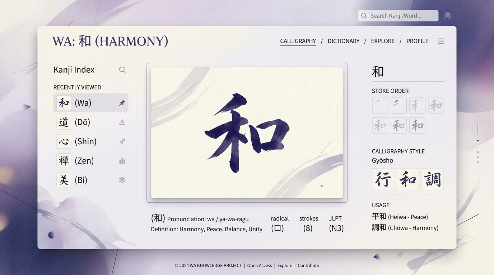

---
hide:
  - navigation
  - toc
---

  

    

      🌊 Iniciativa Balear de Tecnologia i Dades
    

    <h1 class="bt-hero-title">
      Tecnologia, dades i futur per a les Illes Balears
    </h1>
    

      <strong>balears.tech</strong> és un projecte balear per ajudar les empreses locals a créixer amb la tecnologia i les dades. Combinam consultoria tecnològica d'alt nivell per al teixit productiu de les illes amb el desenvolupament de projectes altruistes i de codi obert al servei de la comunitat.
    

    

      <a href="#serveis-per-a-empreses" class="bt-btn-primary">
        💼 Consultoria per a empreses
      </a>
      <a href="#projectes-actius" class="bt-btn-secondary">
        🚀 Explorar projectes actius
      </a>
    

    

      📍 Mallorca
      •
      Menorca
      •
      Eivissa
      •
      Formentera
    

  

  

    
    

      ⚡
      

        <strong>Impacte local real</strong> 
        <small style="color: #64748b;">Consultoria àgil & projectes oberts</small>
      

    

  

---

<h2 id="model" style="text-align: center; margin-top: 3.5rem; font-size: 2.1rem; font-weight: 800; color: #003d69;">
  Un model tecnològic arrelat a les Illes
</h2>

  Apostam per la proximitat, la qualitat tècnica i el retorn de valor al territori balear.

  

    
📊

    <h3 style="margin-top: 0; font-size: 1.25rem; font-weight: 700; color: #003d69;">Consultoria per a PIMEs locals</h3>
    

      Les grans consultores sovint no s'adapten a la realitat ni als pressupostos de les empreses balears. Oferim solucions de Business Intelligence, enginyeria de dades i estratègia tecnològica a mida, sense dependències innecessàries.
    

  

  

    
🌿

    <h3 style="margin-top: 0; font-size: 1.25rem; font-weight: 700; color: #003d69;">Projectes oberts i altruistes</h3>
    

      Creiem fermament en retornar coneixement a la societat. Desenvolupam iniciatives de codi obert i eines públiques per a la joventut, la natura, l'educació i el teixit associatiu insular.
    

  

  

    
⚙️

    <h3 style="margin-top: 0; font-size: 1.25rem; font-weight: 700; color: #003d69;">Sobirania i eficiència digital</h3>
    

      Empram arquitectures modernes al núvol (Cloud Run, Python, SQL, eines obertes) per construir solucions lleugeres, ràpides i sense llicències desmesurades que lliguin la teva organització.
    

  

---

  

    
Subdominis & Iniciatives

    <h2 id="projectes-actius" style="margin: 0; font-size: 2.1rem; font-weight: 800; color: #003d69;">
      Els nostres projectes actius a la xarxa
    </h2>
  

  

    Diferents eines i plataformes funcionen sota els subdominis de <strong>balears.tech</strong>, cadascuna amb un propòsit específic.
  

  <!-- escoltes.balears.tech -->
  

    
    

      

        Codi Obert · Joventut
      

      <h3 class="bt-card-title">escoltes.balears.tech</h3>
      

        <strong>Portal d'excursions per a escoltes i guies de Mallorca</strong>. Plataforma col·laborativa amb més de 65 rutes catalogades per unitats, 45 refugis i zones d'acampada legal, xarxa de transport TIB, previsió meteorològica d'AEMET per a 53 municipis i consells d'emergències (112, IBANAT).
      

      

        <a href="https://escoltes.balears.tech" target="_blank" rel="noopener noreferrer" class="bt-card-link">
          Obrir escoltes.balears.tech ↗
        </a>
      

    

  

  <!-- jisho.balears.tech -->
  

    
    

      

        Cloud Run · Dades Obertes
      

      <h3 class="bt-card-title">jisho.balears.tech</h3>
      

        <strong>Murasaki no Jisho (紫の辞書)</strong>. Diccionari interactiu japonès-espanyol amb més de 34.300 entrades, kanji, hiragana, rōmaji i pronunciació d'àudio. Desplegat com a microservei d'alt rendiment a Google Cloud Run alimentat per les bases de dades lliures JMdict, KANJIDIC2 i Tatoeba.
      

      

        <a href="https://jisho.balears.tech" target="_blank" rel="noopener noreferrer" class="bt-card-link">
          Obrir jisho.balears.tech ↗
        </a>
      

    

  

  <!-- data-partner.xyz -->
  

    
    

      

        Consultoria Professional
      

      <h3 class="bt-card-title">data-partner.xyz</h3>
      

        <strong>El teu soci tecnològic de dades i negoci</strong>. El braç de consultoria especialitzada liderat per Gabriel Rul-lan. Des de la unificació de dades fins a quadres de comandament executius i govern de la informació, dissenyat específicament per a empreses que volen resultats tangibles.
      

      

        <a href="https://data-partner.xyz/ca/" target="_blank" rel="noopener noreferrer" class="bt-card-link">
          Visitar data-partner.xyz ↗
        </a>
      

    

  

---

  

    
+13

    
Anys d'experiència tècnica

  

  

    
+65

    
Rutes i refugis catalogats

  

  

    
+34k

    
Entrades de dades obertes

  

  

    
4

    
Illes Balears ateses

  

---

  
Àrea de Consultoria

  <h2 style="font-size: 2.1rem; font-weight: 800; color: #003d69; margin-top: 0.5rem;">
    Com ajudem a créixer el teu negoci local
  </h2>
  

    Moltes empreses balears acumulen informació en fulls de càlcul, ERPs inconnexos o eines aïllades sense treure'n profit real. No venem solucions prefabricades: analitzem la teva realitat i construïm la solució exacta que necessites.
  

  

    

      <h3 style="margin-top: 0; font-size: 1.2rem; font-weight: 700; color: #003d69;">
        🎯 Simplificació i Integració de Dades
      </h3>
      

        Unifiquem les teves fonts d'informació disperses en un sol dipòsit fiable. Automatitzam pipelines d'ingesta perquè deixis de perdre hores copiant dades a mà i puguis prendre decisions basades en evidències reals.
      

    

    

      <h3 style="margin-top: 0; font-size: 1.2rem; font-weight: 700; color: #003d69;">
        📈 Business Intelligence i Quadres de Comandament
      </h3>
      

        Creació d'informes interactius i dashboards clars (Power BI, Looker Studio, Metabase) adaptats a la direcció i equips operatius, alertant sobre mètriques crítiques de vendes, marges i costos.
      

    

    

      <h3 style="margin-top: 0; font-size: 1.2rem; font-weight: 700; color: #003d69;">
        🛡️ Protecció i Optimització de Costos
      </h3>
      

        Avaluam la teva infraestructura tecnològica per evitar sobrecostos en eines i llicències que no utilitzes. Redueix riscos operatius i millora la seguretat de les dades del teu negoci.
      

    

    

      <h3 style="margin-top: 0; font-size: 1.2rem; font-weight: 700; color: #003d69;">
        🤝 Oficina de Dades com a Servei (Data Partner)
      </h3>
      

        Sense la necessitat de contractar un equip intern complet des del primer dia: dissenyam el model de dades, engegam el sistema i formam el teu personal perquè el pugui operar amb total autonomia.
      

    

  

---

  

    
    

      <strong style="display: block; font-size: 1.1rem; color: #003d69;">Gabriel Rul-lan</strong>
      Fundador & Data Partner
    

  

  

    
Trajectòria Professional

    <h3 style="margin: 0.25rem 0 0.75rem; font-size: 1.6rem; font-weight: 800; color: #003d69;">
      Expertesa global, compromís balear
    </h3>
    

      Sóc <strong>Gabriel Rul-lan</strong>, IT Project Manager Sènior i Data Partner amb més de 13 anys d'experiència en direcció de projectes de govern del dada, enginyeria analítica i intel·ligència de negoci. Sóc <strong>Llicenciat en Matemàtiques per la Universitat de les Illes Balears (UIB)</strong>, Master en Administració d'Empreses (ESERP) i certificat <strong>PMP® pel Project Management Institute</strong>.
    

    

      He liderat equips i solucions analítiques per a multinacionals i organitzacions líders com <em>AstraZeneca</em>, <em>MAPFRE</em>, <em>Boehringer Ingelheim</em>, <em>Movinga</em>, <em>APSL</em> i <em>SDG Group</em>. Vaig fundar <strong>balears.tech</strong> amb un objectiu clar: acostar aquesta qualitat i visió tecnològica al nostre teixit local, combinant assessorament professional honest amb projectes oberts d'utilitat pública per a la nostra societat.
    

    

      <a href="https://www.linkedin.com/in/gabriel-rullan/" target="_blank" rel="noopener noreferrer" style="font-weight: 700; color: #00558f; text-decoration: none; font-size: 0.9rem;">
        LinkedIn ↗
      </a>
      |
      <a href="https://t.me/gabriel_rullan" target="_blank" rel="noopener noreferrer" style="font-weight: 700; color: #00558f; text-decoration: none; font-size: 0.9rem;">
        Telegram (@gabriel_rullan) ↗
      </a>
      |
      <a href="https://data-partner.xyz/ca/" target="_blank" rel="noopener noreferrer" style="font-weight: 700; color: #0ea5a8; text-decoration: none; font-size: 0.9rem;">
        Web personal (data-partner.xyz) ↗
      </a>
    

  

---

  <h2>Xerrem sobre com la tecnologia pot impulsar el teu negoci?</h2>
  

    Tant si cerques estructurar les dades de la teva empresa com si vols conèixer millor alguna de les iniciatives de balears.tech, estarem encantats d'escoltar-te.
  

  

    <a href="https://calendar.app.google/YbQTidmXT3Bg9wdY8" target="_blank" rel="noopener noreferrer" class="bt-btn-calendar">
      📅 Agenda una reunió
    </a>
    <a href="mailto:gabriel@data-partner.xyz" class="bt-btn-light">
      ✉️ gabriel@data-partner.xyz
    </a>
    <a href="https://t.me/gabriel_rullan" target="_blank" rel="noopener noreferrer" class="bt-btn-light">
      💬 Telegram: @gabriel_rullan
    </a>
    <a href="tel:+34638952623" class="bt-btn-light">
      📞 +34 638 95 26 23
    </a>
  

